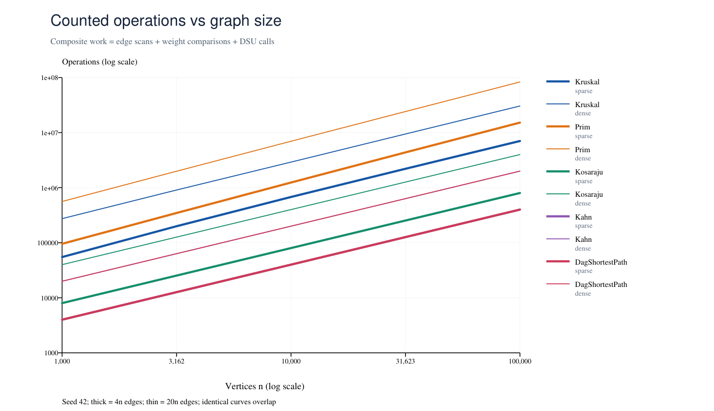
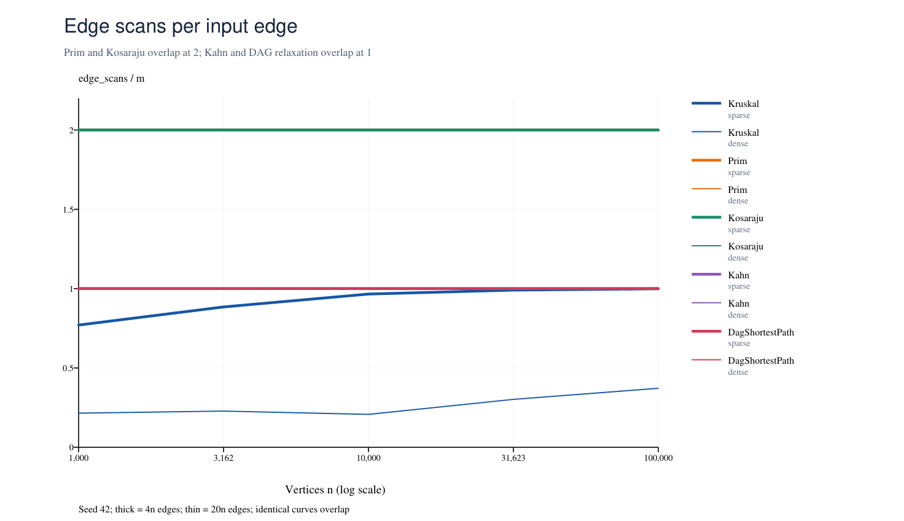
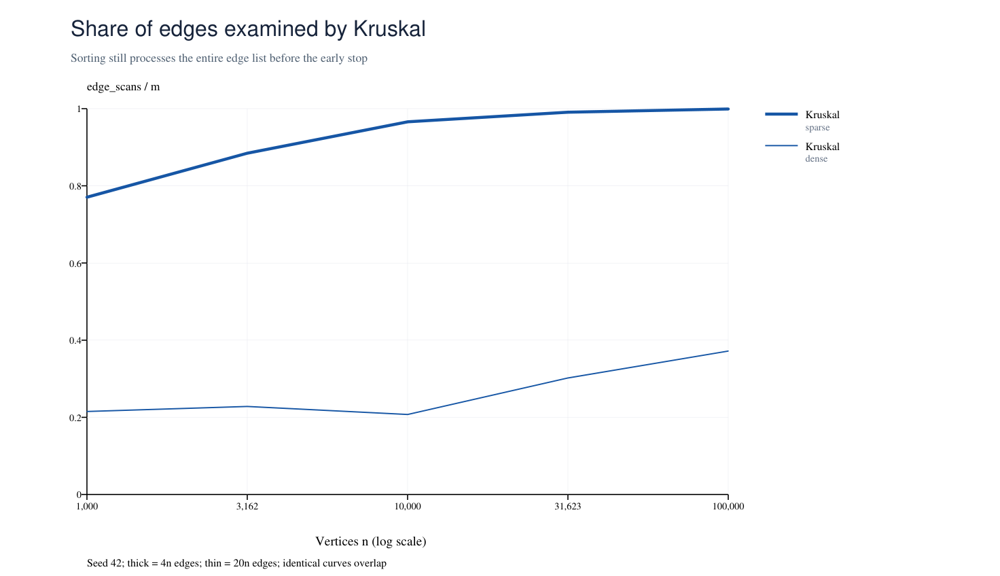

## Assignment 3: City Network & Job Scheduler

Alua Rakhimzhanova | SE-2509 | 23 October 2026

## 1. Implementation and experiment

One adjacency-list Graph supports directed and undirected edges. Vertices use int IDs and edge weights use int; total weights and distances use long to prevent int overflow. The implementation handles self-loops, parallel edges, isolated vertices and disconnected graphs. DSU uses union by size and iterative path compression. Kosaraju and the bonus Tarjan both use explicit arrays as DFS stacks, so neither needs recursive DFS.

Each of the five sizes (1,000; 3,162; 10,000; 31,623; 100,000) is tested with m = 4n and m = 20n. Each pair has three separately generated graph kinds. Every generation starts with a fresh Random(42). The undirected generator shuffles a permutation, creates a spanning tree and adds random edges. The DAG generator shuffles ranks and orients edges by those ranks. A self-loop draw repeats only the second endpoint; this detail is necessary to reproduce the reference table.

## 2. Complexity of this implementation

| Operation | Time | Extra space | Reason |
| --- | --- | --- | --- |
| DSU find / union | O(alpha(V)) amortized | O(V) total | Size balancing plus path compression; O(1) local space. |
| DSU makeSet | O(V) | O(V) | Initialize parent and size arrays. |
| Kruskal | O(V + E log E) | O(V + E) | Sort a copied edge list, then DSU checks. |
| Prim (lazy heap) | O(V + E log E) | O(V + E) | Each adjacency entry is scanned; heap may hold O(E) edges. |
| Kosaraju | O(V + E) | O(V + E) | Two passes and a stored transpose; explicit stacks. |
| Kahn | O(V + E) | O(V) | In-degrees, queue and output order. |
| DAG shortest / longest | O(V + E) | O(V) | Kahn order, source initialization and one relaxation pass. |
| Tarjan (bonus) | O(V + E) | O(V) | One DFS pass with index, lowlink and active stack. |
| Condensation (bonus) | O(V + E) expected | O(V + E) | Hash map merges parallel component edges. |

Space excludes the input graph but includes algorithm output. The O(V) term matters when vertices are isolated or E = 0. Prim here stores candidate edges, not an indexed decrease-key heap. With parallel edges E need not be bounded by V squared, so O(E log E) is the honest heap bound for this version.

## 3. Counter definitions

edgeScans counts Kruskal candidates or adjacency entries read during the named traversal. Kosaraju counts its two DFS passes; building the transpose is separate preprocessing. Kahn counts queue-processing scans, excluding in-degree construction. DAG paths count relaxation scans; their internal Kahn call has separate metrics. Therefore the required scan counts are exactly 2m, m and m, although complete methods also perform linear preprocessing. Prim scans 2m because an undirected edge has two adjacency entries.

comparisons counts weight-comparator calls in sort or heap. dsuOps counts public find calls and successful unions, including finds called inside union. maxDepth is peak occupied DFS-stack size, with a root at depth 1. The work proxy W = edgeScans + comparisons + dsuOps is counted in the algorithms; it is not a count of every machine instruction or pointer traversal.

## 4. Correctness arguments

## Cut property and minimum spanning forests

Consider a cut that does not split an already chosen forest component. Let e be a lightest edge crossing that cut. If a minimum spanning tree already contains e, it needs no change. Otherwise, adding e to that tree creates a cycle. The cycle contains another crossing edge f, and weight(e) is no greater than weight(f). Replacing f with e preserves a spanning tree without increasing its weight, so e is safe. Kruskal applies this rule when it joins two DSU components in increasing weight order, and Prim applies it to the cut between visited and unvisited vertices. Restarting Prim in each unvisited component, or processing all useful Kruskal edges, gives a minimum spanning forest when the graph is disconnected.

## Induction on topological order

Every predecessor of a vertex appears earlier in a topological order. All vertices of in-degree zero start at distance zero, which is equivalent to adding a virtual zero-weight super-source. A source already has its correct distance because it has no incoming edge. Assume all earlier vertices have their correct distances. When the current vertex is processed, every possible final incoming edge has already been relaxed from its predecessor. Its distance is therefore the minimum over all such path extensions, so the induction continues. Negative weights are safe because a DAG has no cycle to revisit; in a general graph, a reachable negative cycle can make shortest distances unbounded and a topological pass is unavailable.

## 5. Which algorithm when

| Situation | Choice | Why |
| --- | --- | --- |
| Sparse undirected graph; edge list | Kruskal | Simple sorting plus DSU; forest is natural. |
| Undirected graph already in adjacency lists | Prim | Grow locally from a vertex; no separate sorted list. |
| Very dense graph | Compare representations | This lazy Prim has O(E log E) work; matrix Prim O(V squared) can be preferable, but is not this implementation. |
| Directed graph; cycles/deadlocks possible | Kosaraju / Tarjan | Find maximal groups of mutually reachable jobs. |
| Need a job order or cycle detection | Kahn | If fewer than V vertices leave the queue, reject the order. |
| Shortest paths in a DAG, negative weights allowed | Topological relaxation | O(V + E); no heap or repeated passes needed. |
| General graph shortest paths | Dijkstra / Bellman-Ford | Dijkstra needs nonnegative weights; Bellman-Ford supports negative edges and detects reachable negative cycles. |

## 6. Bonus tasks

Tarjan records index[v] when a vertex is discovered. low[v] tracks the earliest active index reachable through its DFS subtree. An edge to an active vertex uses that vertex's index, while a completed DFS child propagates its lowlink to its parent. When low[v] equals index[v], active vertices are popped through v to form one SCC. Tarjan scans m edges, while Kosaraju scans 2m in its two passes and also constructs a transpose. IDs may differ, so tests compare the component partition rather than raw labels.

Condensation replaces every SCC by one vertex and removes internal edges. A cycle between distinct SCCs would make them mutually reachable, contradicting maximality; thus the result is a DAG. Parallel component edges retain their maximum weight for the longest-path model. The longest-path routine uses the same topological pass as shortest paths, with the comparison reversed, which is equivalent to negating weights without int-negation overflow. It starts at all zero-in-degree components. This models the critical chain of dependencies in scheduling; durations inside a cyclic SCC need a separate model. Longest simple paths are hard in general graphs (NP-hard), while allowing repeated vertices can make a positive cycle unbounded; neither obstacle exists in a DAG.

## 7. Reference values and independent validation

| n / m | MST weight | SCCs | DAG sum | Reference |
| --- | --- | --- | --- | --- |
| 1,000 / 4,000 | 147,970 | 27 | 396,274 | PASS |
| 1,000 / 20,000 | 30,363 | 1 | 252,411 | PASS |
| 3,162 / 12,648 | 468,911 | 137 | 1,271,911 | PASS |
| 3,162 / 63,240 | 97,589 | 1 | 723,157 | PASS |
| 10,000 / 40,000 | 1,486,139 | 373 | 3,941,828 | PASS |
| 10,000 / 200,000 | 309,550 | 1 | 2,381,342 | PASS |
| 31,623 / 126,492 | 4,715,515 | 1188 | 12,551,891 | PASS |
| 31,623 / 632,460 | 968,517 | 1 | 7,376,612 | PASS |
| 100,000 / 400,000 | 15,012,094 | 3923 | 40,096,539 | PASS |
| 100,000 / 2,000,000 | 3,056,681 | 1 | 23,512,087 | PASS |

All ten reference rows match. Both MST algorithms agree and return n - 1 tree edges on generated connected graphs. Kahn returns n vertices and every directed edge satisfies pos[u] < pos[v]. Kosaraju has exactly 2m scans; Kahn and DAG relaxation each have m scans. The CSV has 50 rows and records medians of five runs, not invented times. The benchmark also checks that results and operation counters stay identical across those five runs.

## Tests

The JUnit suite has 10 tests with no failures. DSU is checked after 1,000 random unions against a label-based reference. MSTs are compared on 100 connected random graphs and on 30 tiny graphs against exhaustive spanning-tree enumeration. Both SCC algorithms are checked on 100 random graphs of up to 200 vertices against BFS reachability in both directions. Topological validation rejects duplicates, missing vertices, wrong orders and cycles. On 100 random DAGs, shortest and longest distances match independent Bellman-Ford-style repeated relaxation, including negative weights; restored paths are checked too. Both SCC implementations finish a 100,000-vertex path and then a 100,000-vertex cycle without recursive DFS. File graphs, empty inputs, parallel edges, self-loops, isolated vertices and long totals are also tested.

## Bonus measurements

| n / m | Kosaraju scans | Tarjan scans | DAG edges | Critical weight |
| --- | --- | --- | --- | --- |
| 1,000 / 4,000 | 8,000 | 4,000 | 28 | 3053 |
| 1,000 / 20,000 | 40,000 | 20,000 | 0 | 0 |
| 3,162 / 12,648 | 25,296 | 12,648 | 149 | 2992 |
| 3,162 / 63,240 | 126,480 | 63,240 | 0 | 0 |
| 10,000 / 40,000 | 80,000 | 40,000 | 409 | 3779 |
| 10,000 / 200,000 | 400,000 | 200,000 | 0 | 0 |
| 31,623 / 126,492 | 252,984 | 126,492 | 1299 | 3952 |
| 31,623 / 632,460 | 1,264,920 | 632,460 | 0 | 0 |
| 100,000 / 400,000 | 800,000 | 400,000 | 4331 | 4977 |
| 100,000 / 2,000,000 | 4,000,000 | 2,000,000 | 0 | 0 |

Every bonus graph passes partition equality and condensation topological validation. Dense random directed graphs each form one SCC, so their condensation has one vertex, no edges and critical weight zero. The small cyclic file gives a nontrivial example: 4 SCCs, 2 condensation edges and critical weight 12. Full restored critical paths are recorded in results/bonus.csv.

## 8. Measured work and scans

The first chart uses W on log-log axes, with one series for each main algorithm and density. The second divides scans by m. Identical curves overlap: Prim and Kosaraju equal 2, while Kahn and DAG relaxation equal 1. These exact ratios validate traversal work; they do not include heap or sorting comparisons.

Kruskal's scan fraction is not flat because it stops after V - 1 accepted edges on connected graphs. That early stop affects candidate scanning only; sorting still sees all E input edges. All plotted values are read from the included CSV by scripts/analyze.py.

## 9. Normalized counters and fitted slopes

For each density, ordinary least squares fits log(counter) against log(n). The normalization uses W / (m log2(m)) for MSTs and W / (n + m) for traversals. The table shows the minimum-to-maximum ratio across all five sizes; full values are in results/analysis.json. Since m is a fixed multiple of n, all complete traversal scan slopes are exactly 1.00.

| Algorithm / density | Divisor for W | Ratio range | Scan slope | W slope |
| --- | --- | --- | --- | --- |
| Kruskal / sparse | m log2(m) | 0.946-1.157 | 1.055 | 1.052 |
| Kruskal / dense | m log2(m) | 0.727-0.958 | 1.119 | 1.022 |
| Prim / sparse | m log2(m) | 1.996-2.042 | 1.000 | 1.101 |
| Prim / dense | m log2(m) | 1.965-1.985 | 1.000 | 1.085 |
| Kosaraju / sparse | n + m | 1.600-1.600 | 1.000 | 1.000 |
| Kosaraju / dense | n + m | 1.905-1.905 | 1.000 | 1.000 |
| Kahn / sparse | n + m | 0.800-0.800 | 1.000 | 1.000 |
| Kahn / dense | n + m | 0.952-0.952 | 1.000 | 1.000 |
| DagShortestPath / sparse | n + m | 0.800-0.800 | 1.000 | 1.000 |
| DagShortestPath / dense | n + m | 0.952-0.952 | 1.000 | 1.000 |

Kruskal's scan slopes are 1.055 (sparse) and 1.119 (dense), while its comparator slopes are 1.055 and 1.016. A scan-only slope cannot establish E log E sorting complexity. Early stopping changes the scan fraction; bounded weights (1..1,000), repeated keys and adaptive library sorting also influence measured comparisons. Normalized MST work remains of similar magnitude rather than exactly constant; these finite measurements are consistent with the stated bounds, not a proof of them. Kruskal dsuOps/m ranges from 2.290 to 2.748 (sparse) and 0.565 to 0.894 (dense); calls alone cannot demonstrate alpha(V).

Kruskal examines 77.05%-99.92% of sparse edges but only 20.74%-37.18% of dense edges. At n = 100,000 and m = 2,000,000 it scans 743,572 candidates versus Prim's 4,000,000 adjacency entries, and makes 27,890,128 weight comparisons versus Prim's 79,103,986. This explains its lower counted work on these graphs, without implying that it always wins on other inputs.

## Time measurements

On the included Java 25.0.1 run, dense Kruskal medians rise from 21.632 ms to 1218.042 ms; dense Prim rises from 21.459 ms to 3569.864 ms. Timed tasks include result construction and immediate checks; Kahn also validates its order. Small-input times are noisy due to JVM compilation, allocation and background load. Hardware, JVM and garbage collection change times, so the counters and independent correctness checks provide the main evidence.
